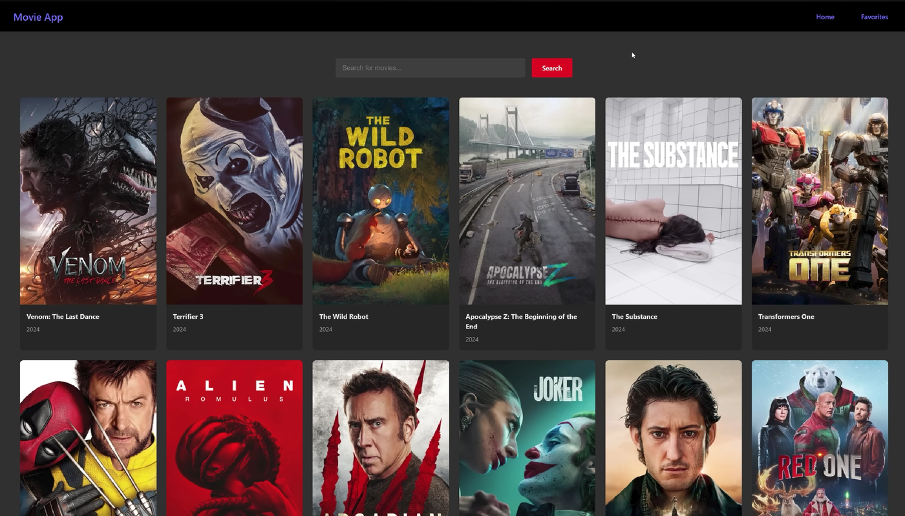
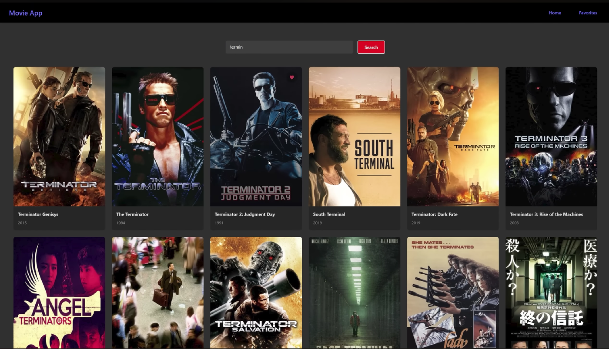
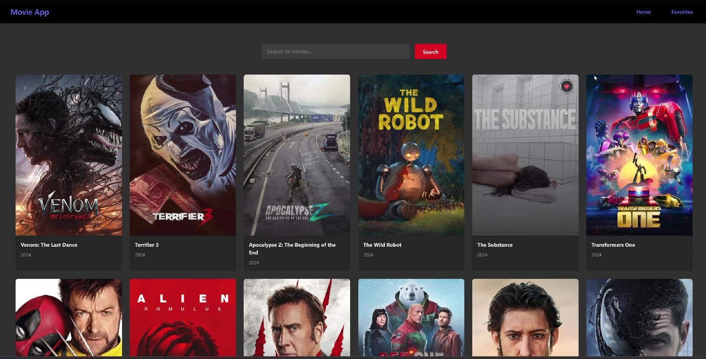
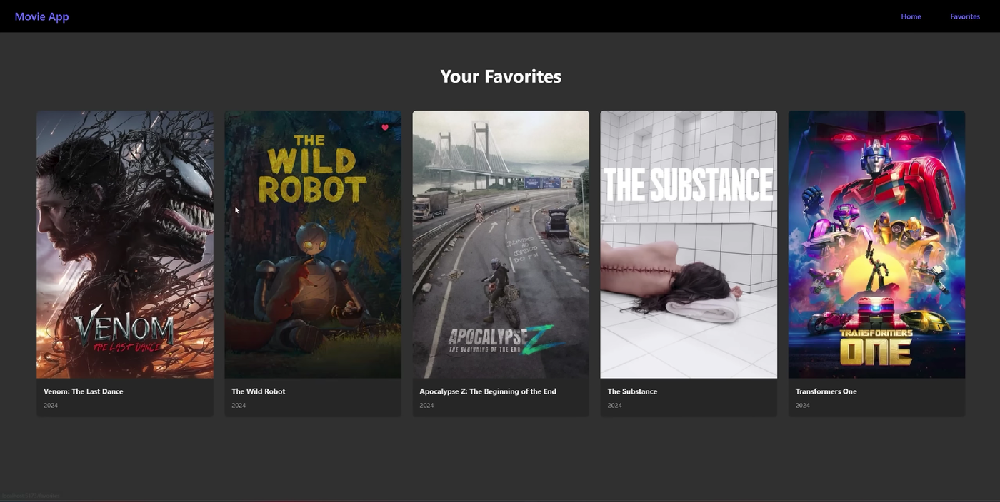

# React Movie Dashboard

A responsive movie browsing app built with **React** and **Vite**. It shows popular movies, lets you search for any title, and lets you save your favorite movies to a personal Favorites page. Movie data comes from the [TMDB API](https://www.themoviedb.org/documentation/api).

---

## Table of Contents

- [Features](#features)
- [Screenshots](#screenshots)
- [Tech Stack](#tech-stack)
- [Project Structure](#project-structure)
- [Getting Started](#getting-started)
- [Available Scripts](#available-scripts)
- [How It Works](#how-it-works)
- [Acknowledgements](#acknowledgements)

---

## Features

- Browse a grid of currently popular movies
- Search movies by title
- Add or remove a movie from favorites with one click on the heart button
- Dedicated Favorites page
- Favorites are saved in the browser (`localStorage`), so they are kept after a refresh
- Client-side routing between pages with React Router
- Loading and error messages for API requests
- Dark, responsive card layout

---

## Screenshots

### 1. Home Page: Popular Movies

The home page loads popular movies from TMDB when the app opens.



### 2. Search Movies

Type a title in the search bar and press **Search** to see matching results.



### 3. Add a Movie to Favorites

Hover over a movie poster and click the heart button to add it to favorites. Click it again to remove it.



### 4. Favorites Page

All the movies you saved are shown here.



---

## Tech Stack

| Area             | Technology                                                          |
| ---------------- | ------------------------------------------------------------------- |
| UI library       | React 18                                                            |
| Build tool       | Vite 5                                                              |
| Routing          | React Router DOM 6                                                  |
| State management | React Context API and hooks (`useState`, `useEffect`, `useContext`) |
| Data source      | TMDB (The Movie Database) API                                       |
| Persistence      | Browser `localStorage`                                              |
| Styling          | Plain CSS                                                           |
| Linting          | ESLint                                                              |

---

## Project Structure

```
React_movie_dashboard/
├── public/
├── screenshots/              # Images used in this README
├── src/
│   ├── components/
│   │   ├── MovieCard.jsx     # Single movie card with favorite button
│   │   └── NavBar.jsx        # Top navigation bar
│   ├── contexts/
│   │   └── MovieContext.jsx  # Favorites state shared across the app
│   ├── css/                  # Stylesheets for each component and page
│   ├── pages/
│   │   ├── Home.jsx          # Popular movies and search
│   │   └── Favorites.jsx     # Saved movies
│   ├── services/
│   │   └── api.js            # TMDB API calls
│   ├── App.jsx               # Routes and layout
│   └── main.jsx              # App entry point
├── .env.example              # Example environment variable file
├── index.html
├── package.json
└── vite.config.js
```

---

## Getting Started

### Prerequisites

- [Node.js](https://nodejs.org/) (LTS version) and npm
- A free TMDB API key

### 1. Download the code

```bash
git clone https://github.com/prathmeshmane013-commits/React_movie_dashboard.git
cd React_movie_dashboard
```

### 2. Install dependencies

```bash
npm install
```

### 3. Get a TMDB API key

1. Create a free account at [themoviedb.org](https://www.themoviedb.org/).
2. Go to **Settings → API** and request an API key.
3. Copy the **API Key (v3 auth)**.

### 4. Add your API key

Create a file named `.env.local` in the project root and add:

```
VITE_TMDB_API_KEY=your_tmdb_api_key_here
```

You can copy `.env.example` as a starting point. `.env.local` is already listed in `.gitignore`, so your key will not be uploaded to GitHub.

### 5. Start the app

```bash
npm run dev
```

Open the local address shown in the terminal, usually `http://localhost:5173/`.

---

## Available Scripts

| Command           | What it does                                    |
| ----------------- | ----------------------------------------------- |
| `npm run dev`     | Starts the development server with hot reload   |
| `npm run build`   | Creates a production build in the `dist` folder |
| `npm run preview` | Previews the production build locally           |
| `npm run lint`    | Checks the code with ESLint                     |

---

## How It Works

- **`main.jsx`** mounts the app inside `BrowserRouter` so pages can change without a full reload.
- **`App.jsx`** wraps everything in `MovieProvider` and defines two routes: `/` (Home) and `/favorites` (Favorites).
- **`services/api.js`** has `getPopularMovies()` and `searchMovies(query)`, which call the TMDB API.
- **`MovieContext.jsx`** keeps the favorites list in React Context and syncs it with `localStorage`. It provides `addToFavorites`, `removeFromFavorites` and `isFavorite`.
- **`Home.jsx`** fetches popular movies on load, handles search, and shows loading and error states.
- **`MovieCard.jsx`** displays the poster, title and release year, and the favorite toggle.

---

## Acknowledgements

- Movie data and images are provided by [TMDB](https://www.themoviedb.org/). This product uses the TMDB API but is not endorsed or certified by TMDB.
- This project is based on the [Learn React In One Project](https://github.com/techwithtim/Learn-React-In-One-Project) tutorial by Tech With Tim. I built it by following his tutorial to learn React.
